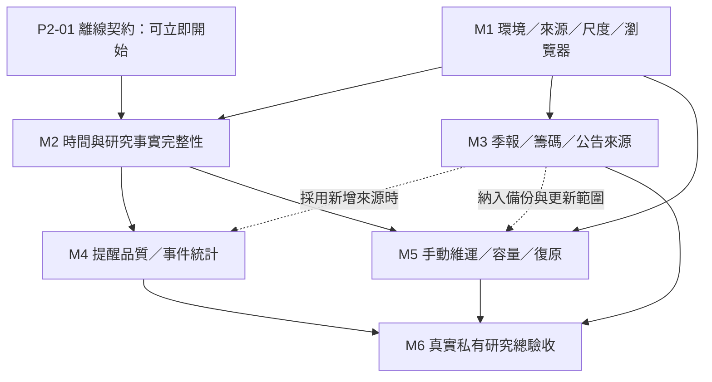

# 真實私有研究可用：里程碑與一次確認包

日期：2026-11-17（Asia/Taipei）。
盤點 HEAD：`8adf7f68fdbb4b221686bcf45c2c83b596902795`；起始工作區乾淨。
本地 `main` 與已存在的 `origin/main` tracking ref 相同；本輪沒有 fetch，未聲稱已查到遠端即時 HEAD。

**Review:** 使用者於 2026-11-17 授權依本規格實作、TDD、整合與審查；執行驗收仍依實際證據判定。
**Status:** claimed

**環境修訂：** 使用者已指示本輪在當前 macOS 環境測試，M1 不等待 Linux；Linux／NAS 移轉驗收仍未執行。規格與 01／02 票已記錄此修訂。

入口：[第一里程碑規格](spec.md) · [逐票清單](#任務拆分) · [程式盤點](inventory.md) · [原 backlog](../../docs/DEVELOPMENT_BACKLOG.md) · [已確認決策](../../docs/HANDOFF.md)。

這次只建立規劃文件，不下載金融資料、不實作產品、不變更 parent backlog 狀態。每張 ticket 連回原 ID；本地詳細 tracker 依 [issue-tracker](../../docs/agents/issue-tracker.md)。
本輪驗證範圍及結果見文末。

## 目標與完成邊界

「真實私有研究可用」是：在目標 Linux／Python 3.11 環境，以明確自選股票及逐來源驗收的真實資料，手動完成擷取、正規化、SQLite、文字語意、兩類獨立提醒、不可變研究版本、稽核、歷史比較與事件描述統計，並有尺度／時間／完整性、獨立抽檢、容量與復原證據。

第一里程碑 M1 只完成環境、來源及瀏覽器的基礎驗收。M1 完成不能關閉其餘 backlog，也不能宣稱完整研究歷史已可用。

全程沿用 SQLite、uv、既定模型、Cytoscape、main/root Pages、盤後手動、自選股票、兩類提醒分開及 A 描述統計。TW50＋009816 聯集決策保留，名單暫緩。REL-01／REL-02 與 HOLD-01／HOLD-02 不納入本次私有完成閘門，且仍保留待辦。

## 有相依關係的里程碑

| 里程碑 | 原 backlog | 真正的前置依賴 | 可驗收交付與退出條件 |
| --- | --- | --- | --- |
| M1 真實資料基礎驗收 | P0-01、P0-02、P1-01、P1-02 | 開始無其他功能阻擋；真實執行需要可用目標環境／網路 | 鎖定環境＋真實模型四情境；四類來源全檔證據；財務／行情獨立抽檢；真實瀏覽器三頁；分市場私有端到端 audit；各證據標明真實或合成，無受阻項冒充完成 |
| M2 研究事實與時間完整性 | P2-01、P2-02、P2-03、P2-04 | P2-01 離線部分立即開始；日曆／價格／修訂的真實驗收依賴 M1 對應來源與尺度 | 未裁剪數值契約；權威交易日及缺口分類；公司行為可比較性；撤回／修訂／晚到資料的可重建時間語意；新舊版本與資料不足明示 |
| M3 擴充研究證據來源 | P1-03、P1-04、P1-05 | 季度三表依賴 P1-01／P1-02；籌碼／公告各自依賴來源審核，可與 M2 平行 | 按市場、產業、報表適配並抽檢；至少逐一落實 backlog 的季度三表、法人／融資融券及公告／新聞／產業證據能力；範圍、權利與不支援項明列，不能以月營收取代季報 |
| M4 真實研究品質與描述統計 | P3-01、P4A-01 | P3-01：P1-02＋P2-01／02／03／04；P4A-01：P2-01／02／04，價格可比較性亦需 P2-03；採用 M3 新來源時再依賴該適配器 | 六條規則逐條列有效／不可計算分母與人工案例；事件去重、首次保存值、右設限、重疊及選擇偏誤揭露；不因圖譜裁剪改分母，不變策略回測 |
| M5 手動維運與可復原性 | P0-03、P2-05、P2-06、OPS-01 | 合成容量盤點、備份工具驗證可先做；手動整合需 M1 對應來源；最終復原需 M2 契約，納入的 M3 來源也需完成 | DB＋原始證據＋ledger＋bundle＋設定在 Linux／NAS 獨立位置復原並 audit；分階段手動執行、失敗報告及舊 pointer 保全；只讀容量報告、封存 dry-run、固定負載量測 |
| M6 真實私有研究總驗收 | 以上全部相關 ID | M1～M5 的必需交付 | 同一版本／設定的真實資料全流程、獨立抽檢、故障復原及研究範圍清單；來源、時間、樣本、容量限制可從報告追溯；逐項回填 backlog 證據後才宣布達標 |

M3 不是一張大票：後續須按「單一來源族＋一種可用研究行為」另寫規格拆票，且不把待來源核對問題當成本輪使用者必答問題。若外部來源不可用，保留受阻項；只可宣布已驗收子範圍，不能宣稱整個 repo 完成。

P2-05 的**量測與預算閘門**是 M5 必需；ANN／候選索引實作僅在量測證明精確模式不足時啟動。可保留精確模式，但須留下適用尺度及決策證據，不能直接刪除此待辦。P2-06 的刪除與自動回收不在本次授權範圍。

箭頭表示整體退出條件；不要求所有子工作等待整個上游里程碑結束。以下 ticket blockers 才是第一階段可執行順序。

## 第一階段的範圍與測試介面

**主線 M1：01～10；獨立預備線 P2-01：11～12，歸 M2，不阻擋 M1。**

優先重用一條「使用者操作 → 私有產物與可見結果」端到端驗收路徑：
CLI 擷取／匯入 → 真實臨時 SQLite → research → audit → 本機 HTTP → 瀏覽器。
不建立另一套生產框架；回歸測試主要替換來源輸入／外部 transport，內部正規化、DB、匯出與稽核使用真實實作。

| 介面 | 驗收輸入與可觀察輸出 | 現有先例 |
| --- | --- | --- |
| 環境與模型入口 | local.check、research／semantic；exit code、模型 revision、encoded／cache／pairs、匯出與 audit | SemanticTests、ResearchTests；本地 check 報告 |
| 官方來源到研究 bundle | collect_official／official_import／market_prices／research／bundle_audit；原始 hash、回應資訊、全檔輪廓、選股覆蓋、失敗報告與舊 pointer | official adapter、market prices、research 整合測試 |
| 財務抽檢 | financial_review CLI；獨立 reference、比較筆數、差異、尺度、來源與 exit 0／2／error | FinancialReviewTests |
| 真實使用者介面 | preview／research_archive／event_study 的 loopback HTTP；實際瀏覽器 DOM、WebCrypto、失敗恢復；正式 CDN HTTPS 與 Pages 示範只讀探測 | 三個 browser smoke 與 Python HTTP 測試 |
| P2-01 新契約 | 同一 research → audit → event_study → 瀏覽器路徑；改展示上限仍有相同研究事實及統計，未知版本／篡改／超額停止 | EventIntegrationTests、bundle audit、research archive |

內部純規則測試只補難以經上述入口辨識的邊界；不以函式呼叫次數或內部 SQL 形狀當一般功能驗收。模型「全快取不載入」屬明定效能行為，使用既有 loader／encoder 邊界的測量證據，加上報告計數交叉核對。

## 任務拆分

以下為編號清單；每張完整驗收條件在連結內。

1. [01 Linux／Python 3.11 鎖定環境重現](issues/01-locked-environment.md) — **Blocked by：無**。交付可重跑的離線全套檢查、環境／版本／exit code 證據（P0-01）。
2. [02 真實模型與增量快取四情境](issues/02-real-model-cache.md) — **Blocked by：01**。固定 revision，驗證首次、全快取、改一篇、改股票映射，保留可稽核 bundle（P0-01）。
3. [03 圖譜真實瀏覽器與固定 CDN](issues/03-graph-browser.md) — **Blocked by：無**。真實 HTTP／HTTPS、3.30.4、WebCrypto、手機、錯版及失敗恢復（P0-02）。
4. [04 歷史與事件頁真實 HTTP 瀏覽](issues/04-history-event-browser.md) — **Blocked by：無**。保存版本、比較及事件報告在實際瀏覽器可用，錯誤安全且可恢復（P0-02）。
5. [05 公司／月營收全檔到私有研究](issues/05-official-financial-sources.md) — **Blocked by：無**。已啟用 TWSE 公司／營收來源的下載證據、欄位與日期契約、正規化、SQLite、bundle audit（P1-01）。
6. [06 TWSE 行情全檔到私有研究](issues/06-twse-market-source.md) — **Blocked by：無**。上市行情 raw→DB→research→audit；全檔日期及指定股票覆蓋（P1-01）。
7. [07 TPEx 行情全檔到私有研究](issues/07-tpex-market-source.md) — **Blocked by：無**。上櫃行情及其獨立財務輸入完成同一驗收，禁止跨市場混用（P1-01）。
8. [08 月營收單位版本與獨立抽檢](issues/08-financial-unit-review.md) — **Blocked by：05**。證據支持的幣別／尺度／時間／報表範圍，獨立 reference 比對，舊資料不混用（P1-02）。
9. [09 行情單位與交易範圍抽檢](issues/09-market-unit-review.md) — **Blocked by：06、07**。兩市場價格、股／張、成交值與交易範圍逐源核對，版本相容與不可比較行為驗證（P1-02）。
10. [10 M1 真實私有整合驗收與證據索引](issues/10-m1-acceptance.md) — **Blocked by：02、03、04、08、09**。在同一候選版本串起真實來源、抽檢、研究、audit 與三頁，逐項對回四個優先 backlog。
11. [11 未裁剪研究數值的保存與稽核](issues/11-unpruned-facts.md) — **Blocked by：無**。以合成輸入完成不可變新契約、來源連結、版本／容量驗證及舊 bundle 相容（P2-01；M2 預備線）。
12. [12 事件統計改讀新契約並揭露舊版限制](issues/12-event-fact-contract.md) — **Blocked by：11**。新分析版本不受展示上限影響；舊版可讀但不補資料，瀏覽器可辨識樣本範圍（P2-01；M2 預備線）。

確認後的 frontier：01、03、04、05、06、07、11。這表示沒有功能 blockers，不代表本輪已啟動實作或多代理工作。01 的目標環境驗收不是 05～09 離線開發的前置；最後 10 統一驗收目標環境。

06／07 以各市場獨立、合法準備的正規化財務輸入驗證行情串接；不假設 05 的上市股票可供上櫃使用，也不要求先做跨市場單一 run。票內若共用下載紀錄工具，屬小範圍抽取並附於第一條可用路徑，不另設水平基礎設施票。

## 一次確認的內容

請一併確認：

1. 以上 M1／M2 預備線邊界、測試介面與各票完成條件是否符合預期。
2. 12 張票的粒度是否合適；blockers 是否正確，哪些應合併或再拆。
3. P2-01 採「新 bundle 新契約＋新分析版本；舊版維持可讀並分開揭露」的相容策略是否接受。

以上是本次提案確認，沒有重新詢問已確認的架構、股票池、A／B 或提醒方向。未發現必須現在由使用者另選的產品定義。目標 Linux/NAS 執行位置、可用模型快取、真實抽樣股票／日期是實作時的執行輸入；可先盤點環境與來源，只有無法取得時再問必要資訊，勿要求帳密。

預設抽樣下限：每個已驗收市場至少兩檔明確代碼、至少一個來源實際提供的期別／交易日期；每一要宣稱支援的數值欄位至少一筆獨立參考，金額與百分比須分列。這是提出的工程抽檢門檻，不是統計代表性宣稱。零值、缺值、負成長、混日期、錯尺度、撤回等稀少情境可用合成回歸，但不能冒稱真實已抽到。較長歷史與六規則真實樣本評估保留 M4。

預設容許誤差為 0；有原始揭露四捨五入等證據時才記錄理由並調整，不能為了通過報告任意放寬。單位是來源查證事項，不請使用者憑偏好指定。

## 本輪實際驗證

- 讀取 AGENTS、HANDOFF、backlog、tracker／triage／domain、兩個指定 skills 與相關功能文件。
- 核對入口、資料契約、測試及瀏覽器 harness；詳細證據見 inventory。
- 沒有執行產品測試、官方下載、真實模型、瀏覽器或 NAS 演練；410 等既有數字僅為歷史紀錄。
- 文件驗證：15 份 Markdown、12 張獨立 tickets、111 個相對連結均有效；21 個原 backlog ID 均有里程碑／範圍對應，依賴編號由前往後且無循環。
- 首次新檔空白檢查發現 EOF 多餘空行，已修正；重新執行逐檔 git diff --no-index --check 及 git diff --check 通過。變更僅新增本目錄文件；未改 parent backlog、產品程式、lock 或公開示範。
