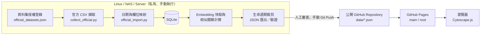

# Architecture｜技術架構

[文件中心](README.md) · [System Design](SYSTEM_DESIGN.md) · [資料模型](DATA_MODEL.md)

本文件描述**目前的實際實作與執行邊界**；不是雲端即時服務的設計圖。

## 1. 部署／執行邊界



**安全邊界：** SQLite、原始快照、模型權重和敏感憑證不應進 Git；網站僅託管可公開的 HTML/CSS/JS/JSON。Repository 是公開的，**原始碼也公開**。

## 2. 元件與責任

| 元件 | 程式入口／檔案 | 責任 |
| --- | --- | --- |
| 瀏覽器 | `index.html`、`js/app.js`、`css/style.css` | 靜態圖譜載入、關聯過濾、詳情面板 |
| 來源閘門 | `local/source_registry.py` | 檢查核准來源與 HTTPS 端點 |
| 官方資料快照 | `local/collect_official.py` | 手動下載、SHA256、私有快照、批次 manifest |
| 官方格式轉換 | `local/official_adapter.py`、`local/official_import.py` | CSV 正規化、日期／單位、股票覆蓋檢查 |
| 本地資料庫 | `local/core.py`、`local/schema.sql` | SQLite schema、匯入、節點、邊及來源紀錄 |
| 語意處理 | `local/semantic.py`、`local/neighbors.py` | 向量快取、精確 Top-K、關聯證據及重用 |
| 展示圖譜 | `local/lifecycle.py`、`local/export_json.py` | 依時間／上限選圖、產生每股 JSON |
| 驗證 | `local/validate_release.py`、`local/check.py` | JSON 完整性與本地測試 |
| 人工發布 | `local/publish.py` | 僅提交核准的 `data/` JSON |
| 交易日檢查 | `local/trading_calendar.py`、`local/run_after_close.py` | 台北日期與盤後手動預覽入口；拒絕自動發布 |

## 3. Repository 目錄

```text
.
├── README.md               # 簡介與文件入口
├── docs/                   # 系統設計、使用與維運文件
├── index.html              # 網站首頁
├── css/                    # 前端樣式
├── js/                     # Cytoscape.js 視覺化
├── data/                   # 公開 manifest / 各股票 graph JSON
├── local/                  # SQLite、ETL、Embedding、測試
│   ├── schema.sql
│   ├── pipeline.py
│   ├── semantic.py
│   ├── export_json.py
│   ├── tests/
│   └── private/             # 本地私有路徑；Git 忽略
├── pyproject.toml
├── uv.lock
└── .github/workflows/      # 既有測試 workflow；非 Pages 發布閘門
```

## 4. 資料與更新路徑

1. 人工觸發已授權官方來源擷取；保存不可變原始快照與來源版本。
2. 依明確自選股票將來源快照正規化；TW50＋009816聯集保留各自日期與來源，名單暫緩不阻塞私有流程。兩市場真實來源已擷取，行情單位／範圍仍待核對。
3. 寫入 SQLite，依模型名稱、revision 及文件雜湊使用已儲存的 float32 Embedding。
4. 運算相似度與跨股票關聯；輸出時使用圖譜生命週期規則控制畫面複雜度。
5. 先在暫存目錄寫入並驗證圖譜，人工檢查後才允許更新公開 `data/`。
6. 維持 GitHub Pages **Deploy from a branch（main / root）**；沒有後端 API server。

## 5. 目前限制

- 精確相似度比較的運算量仍可能隨文件數量呈二次成長；有 `--max-pairs` 與 `--lookback-days`，**尚未實作 ANN**。
- 本地 SQLite 保存歷史資料，但尚未具備完整的雙時間資料版本與歷史回測。
- JSON 目錄替換有驗證、鎖及失敗回復機制，**不是斷電、NAS 或跨 SQLite/檔案系統的完整分散式交易**。
- 私有history頁已有保存版本比較，event頁支援新舊事實範圍揭露；尚無完整歷史時間軸、載入更多或即時市場查詢。

進一步的需求取捨見 [System Design](SYSTEM_DESIGN.md)；操作方式見 [部署與維運](OPERATIONS.md)。
