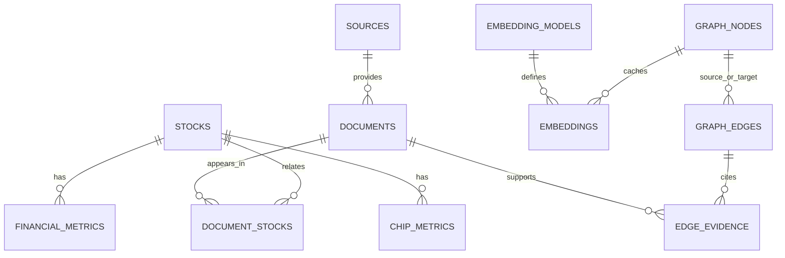

# 資料模型與 JSON 契約｜Data Model

[文件中心](README.md) · [Architecture](ARCHITECTURE.md) · [資料管線](DATA_PIPELINE.md)

## 1. SQLite 是主資料來源

主要定義在 [`local/schema.sql`](../local/schema.sql)。下表列出現行資料表，便於閱讀；完整欄位與限制應以 schema 為準。

| 資料表 | 功能 | 關鍵欄位／關係 |
| --- | --- | --- |
| `stocks` | 股票基本資訊 | `stock_id`（主鍵）、`ticker`、`market`、`name` |
| `sources` | 資料提供者 | `source_id`、`provider`、`url`、`license_type` |
| `documents` | 新聞、公告、財務文件 | `document_id`、`source_id`、`title`、`content_hash`、日期 |
| `document_stocks` | 文件對多檔股票 | 複合主鍵 `(document_id, stock_id)` |
| `financial_metrics` | 財務指標 | 股票、指標、期末日、期間類型、數值、單位 |
| `chip_metrics` | 籌碼指標 | 股票、交易日、指標、數值 |
| `graph_nodes` | 圖譜節點 | `node_id`、`node_type`、`stock_id`／`document_id` |
| `embedding_models` | 模型身分 | `model_id`、維度、組態 JSON |
| `embeddings` | SQLite 向量快取 | `node_id`、`model_id`、`content_hash`、BLOB 向量 |
| `graph_edges` | 圖譜邊 | `source_id`、`target_id`、`relation_type`、`method`、`score` |
| `edge_evidence` | 關聯證據 | `edge_id` 對應 `document_id` |
| `similarity_state` | 免重算狀態 | 模型、輸入／邊雜湊、統計 |
| `pipeline_runs` | 執行紀錄 | 執行時間、結果、錯誤訊息 |



此圖僅示意關係；實際外鍵方向、Nullable 與索引請看 schema。

## 2. ID 與日期慣例

- 股票資料庫 ID：`TW:2330`；公開股票節點：`stock:TW:2330`。不要與舊的展示佔位 ID `stock:2330` 混淆。
- 文件 ID 由來源／股票／日期等建立可穩定識別的 `document_id`；公開圖節點以 `doc:` 為前綴。
- `published_at`：文件宣告發布時間；`available_at`：研究者可取得的時間；`ingested_at`：系統入庫時間。不能用營收月份或期末日取代資訊可得時間。
- 正式官方 adapter 若未取得精確公告時間，只記錄**首次擷取觀察時間**，並標明不等於公告時間。
- `--as-of` 目前主要用於**股票名單生效日**與展示篩選；不是完整歷史 SQLite 快照功能。
- 金額尺度尚未完成正式來源核對時，使用 `source_reported`，禁止自行當成新台幣「元／千元」。

## 3. 公開 JSON 結構

`data/manifest.json` 會列出可供前端選擇的股票；`data/stocks/<ticker>/graph.json` 為各股票圖譜。

**示意欄位，不代表已上線的真實金融資料：**

```json
{
  "schema_version": "1.0",
  "version": "generated-timestamp",
  "generated_at": "2026-11-15T10:00:00+08:00",
  "stocks": [
    {"label": "2330 示例公司", "path": "data/stocks/2330/graph.json"}
  ],
  "sources": []
}
```

```json
{
  "schema_version": "1.0",
  "stock_id": "TW:2330",
  "generated_at": "2026-11-15T10:00:00+08:00",
  "nodes": [
    {"id": "stock:TW:2330", "label": "示例公司", "type": "stock"}
  ],
  "edges": []
}
```

節點最低重要欄位是 `id`、`label`、`type`，可附 `published_at`／`available_at`／`source_id`／描述等屬性。邊有 `id`、`source`、`target`、`relation`，並可包含 `score`、`method`、`model_id`、`as_of`、`evidence_ids`。`score` 若存在必須有限且在 [-1,1]，但**不同類型的關係分數不能混用**。

## 4. JSON 匯出與驗證規範

- `manifest.stocks[].path` 是從網站根目錄起算的相對路徑；不能包含穿越目錄的路徑。
- 每個圖譜的節點 ID／邊 ID 不得重複，所有邊的端點必須存在，禁止自我連線。
- `data/stocks/` 不得殘留沒有被 manifest 列出的舊圖檔。
- 來源與署名欄位只有在實際匯出內容有該資料且通過驗證時才具意義；公開展示是否滿足授權顯名義務仍需人工檢查。
- 展示上限（初版）：主股票 + 最多 100 個資訊節點 + 最多 15 個相關股票，資訊節點語意連線最多 5，新聞通常採 90 天時間窗（啟用 `--lifecycle` 時）。
- 限制只對 JSON 子圖生效，**不表示 SQLite 的完整歷史資料已封存或刪除**。

## 5. 修改 Schema 時

應同步更新 [schema](../local/schema.sql)、[資料處理程式](../local/core.py)、[JSON 匯出](../local/export_json.py)、[單元測試](../local/tests/)與此文件；涉及既有 SQLite 檔案時，需要明確 migration/備份策略，**不是修改 CREATE TABLE 就能更新所有既存資料庫**。

## 私有研究版本擴充（2026-11-16）

`research_snapshots` 在獨立 history DB 保存 canonical SHA256、來源 `observed_at`、本地 `recorded_at` 與不可變 `payload_json`，不修改既有 schema 表。市場價格沿用獨立 `market_price_observations` 表。研究 bundle 的衍生 `graph.db` 才把已核對行情連入 `market_price` 節點，把來源財務指標連入 `financial_metric` 節點，關係分別為 `has_market_price`／`has_financial_metric`、score 為 null；兩者不加入文字模型。

每次建立獨立版本與報告，觀察查詢遵守本地首次登錄時間；不是完整歷史市場資料或企業行為還原。詳見 [私有研究契約](PRIVATE_RESEARCH.md)。

## 可選的研究提醒欄位

每股graph可含 `research_alerts`（`schema_version=research-alerts-1.0`），內容包含該股 `known_at`、完整config及兩個categories：`price_volume`、`monthly_revenue`。6項checks各有status、value、threshold、formula、baseline、evidence及內容ID；不使用graph edge的cosine score。新欄位受完整圖檔SHA256及Python提醒驗證保護，舊圖沒有欄位仍可讀取。完整契約及限制見[研究提醒](RESEARCH_ALERTS.md)。

## 私有歷史與比較契約（2026-11-16）

研究bundle報告新增向後相容的`configuration`，保存計算模式、模型版本、門檻與展示政策。`research-catalog-1.0`是經整包稽核後的版本摘要；`research-comparison-1.0`記錄前後run-ID、截止時間、股票範圍及各自獨立的提醒狀態變化；`financial-review-1.0`是兩個正規化快照的數值差異報告。沒有新增SQLite schema或將歷史版本提交公開data/。詳見[歷史版本](RESEARCH_HISTORY.md)及[財務抽檢](FINANCIAL_REVIEW.md)。
