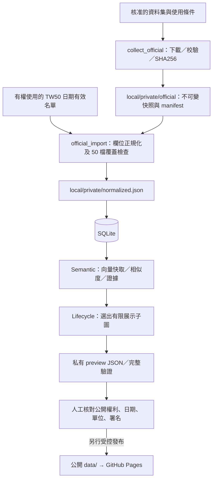

# 資料處理管線｜Data Pipeline

[文件中心](README.md) · [資料模型](DATA_MODEL.md) · [官方資料來源](DATA_SOURCES.md)

本文件描述從可用來源到展示 JSON 的工程步驟；**示範資料與正式資料分開**。目前正式台灣50名單的使用權未確認，官方端點尚未完成線上全量驗證。

## 1. 資料流



## 2. 第一次驗證：完全離線的虛構示範

在 Repository 根目錄：

```bash
uv sync --locked --extra dev
uv run --locked python -m local.check
```

或手動檢查各階段（只寫入臨時檔）：

```bash
uv run --locked python -m local.pipeline all \
  --db /tmp/stock-graph-demo.db \
  --input local/sample_data.json \
  --output /tmp/stock-graph-demo-json \
  --lifecycle
uv run --locked python -m local.pipeline validate --output /tmp/stock-graph-demo-json
```

這裡的 `similarity` 是字元 bigram baseline；真實語意模型需指定 `--semantic`，且首次使用可能下載模型。

## 3. 官方資料（只做人工私有預覽）

前提：已逐資料集確認使用與公開限制，且已有具適用權利、帶生效日期的台灣50名單。不能直接以 ETF 持股或目前網頁當作歷史成分股。

```bash
# 1. 下載已啟用、逐筆審核的官方 CSV → 私有不可變快照
uv run --locked python -m local.collect_official

# 2. 以當日名單篩選「同一天擷取」的快照，要求涵蓋 50 檔
uv run --locked python -m local.official_import \
  --universe local/private/tw50.csv \
  --as-of YYYY-MM-DD

# 3. 在隔離 DB 進行本地語意分析、裁剪並輸出私有預覽
uv run --locked python -m local.pipeline all --semantic \
  --input local/private/normalized.json \
  --db local/private/official-preview.db \
  --universe local/private/tw50.csv --as-of YYYY-MM-DD \
  --lookback-days 90 --threshold 0.65 --lifecycle \
  --output local/private/preview

# 4. 再次驗證輸出；不會推送正式網站
uv run --locked python -m local.pipeline validate --output local/private/preview
```

**把 `YYYY-MM-DD` 換成擷取當天台北日期。** 上述指令是正式資料條件滿足後才能使用的流程範本；現在不能假設官方來源可下載、名單已授權或月營收每日都有新數據。來源頁面與端點見 [資料來源清單](DATA_SOURCES.md)。

## 4. 轉換規則

- 每份來源要有 provider、資料集與授權連結、擷取時間；下載以 SHA256 內容雜湊命名，成功才更新 retrieval manifest。
- 公司和月營收 CSV adapter 會核對官方欄位、民國日期、資料年月、千分位、空值、重複紀錄和 50 檔覆蓋。
- `available_at` 使用資料**實際觀察到可得**的時間；不把月份期末日當成公告時間。當日快照不應被當作歷史當時已可見的資料。
- 金額在單位未核對前以 `source_reported` 保存；零與缺值意義不同。尚未整合價格／籌碼／季報／重大訊息的正式 adapter。
- 一篇文件可以對應多檔股票；文件更新以 ID／內容雜湊配合 SQLite 快取。資料不是每天全量重複造節點。

## 5. 向量與關聯的重算條件

- 模型名稱、revision、輸入版本、文件 hash 一致時，重用 Embedding。
- 全部有效向量命中時不載入模型；文件、股票映射、Top-K 和門檻等也沒變時，可重用既有關聯（`graph_reused=true`）。
- 文件變動需要更新向量；股票對應或演算法參數變動可能需要重建關聯。
- 目前使用有界候選的**精確** Top-K，記憶體約 O(NK)，運算仍可能 O(N²×向量維度)。`--max-pairs` 預設 2,000,000，必要時以 `--lookback-days` 縮小範圍；不是 ANN。
- 圖譜生命週期（`--lifecycle`）限制展示節點與連線；SQLite 的原始歷史資料仍保留。

## 6. 完整資料品質閘門

在開放資料集、授權證明、股票涵蓋、公告／擷取時間、日期合法性、單位、原始快照與 JSON 端點完整性均確認前，僅允許私有預覽。若資料集失敗或不完整，**停止，不用昨天資料或示範資料偽裝今天的成功更新**。

正式發布作業詳見 [部署與維運](OPERATIONS.md)，權利與來源限制詳見 [安全與資料授權](SECURITY_AND_LICENSING.md)。
